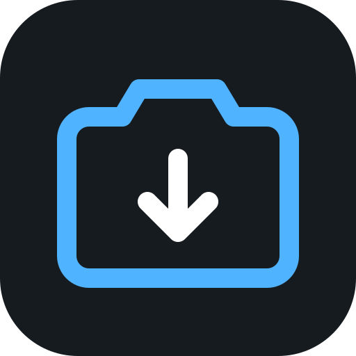
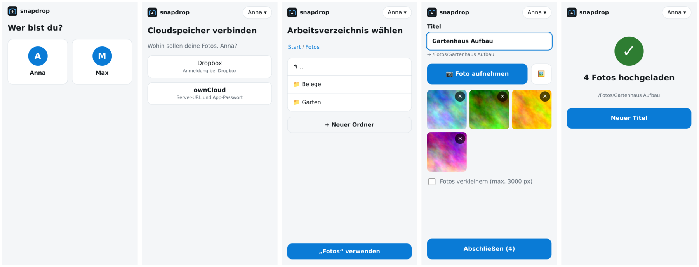

<p align="center">
  
</p>

<h1 align="center">snapdrop</h1>

<p align="center">
  Fotos vom Handy unter einem Titel direkt in <b>Dropbox</b> oder <b>ownCloud/Nextcloud</b> ablegen.<br>
  Selbst gehostet · ohne App-Installation · ein Docker-Container
</p>

<picture>
  <source media="(prefers-color-scheme: dark)" srcset="docs/screenshots/ablauf-dark.png">
  
</picture>

## Wofür?

Ob Belege, Zählerstände, Handwerker-Doku oder Baufortschritt: Man macht ein paar Fotos und will sie sortiert in der eigenen Cloud haben, nicht in der Kamerarolle. snapdrop ist eine kleine Web-App fürs Heimnetz, die genau das erledigt:

1. **User wählen.** Die User stehen in einer Config-Datei, eine Anmeldung gibt es nicht.
2. **Einmalig Cloudspeicher verbinden:** Dropbox per OAuth oder ownCloud/Nextcloud per App-Passwort.
3. **Arbeitsverzeichnis wählen:** durch die eigenen Ordner klicken, bei Bedarf einen neuen anlegen.
4. **Titel eingeben und Fotos aufnehmen,** über die System-Kamera oder aus der Galerie.
5. **Abschließen:** Alle Fotos landen in `<Arbeitsverzeichnis>/<Titel>/`.

Danach startet die App direkt bei Schritt 4.

## Funktionen

- **Mobil zuerst:** als PWA zum Homescreen hinzufügbar, mit hellem und dunklem Design und der nativen Kamera (volle Auflösung, Autofokus, Blitz).
- **Dropbox:** OAuth2-Code-Flow mit Refresh-Token. Zugriff aufs ganze Dropbox, damit man jeden Ordner als Ziel wählen kann.
- **ownCloud / Nextcloud:** WebDAV mit App-Passwort. Die Verbindung wird vor dem Speichern getestet.
- **Saubere Ablage:**
  - Dateinamen nach dem Muster `20261122-143005_01.jpg`.
  - Verbotene Zeichen im Titel werden ersetzt.
  - Ein vorhandener Titel-Ordner wird ergänzt, Namenskonflikte bekommen ein Suffix.
- **Robuster Upload:**
  - Fortschrittsanzeige.
  - Bei Teilfehlern bleiben nur die fehlgeschlagenen Fotos stehen und können erneut gesendet werden.
  - Warnung vor dem Schließen der Seite.
  - Optional Verkleinerung im Browser auf maximal 3000 px.
- **Sichere Zugangsdaten:** Tokens und Passwörter liegen Fernet-verschlüsselt in SQLite, die API gibt nie Secrets heraus.

> [!IMPORTANT]
> snapdrop hat **keine Anmeldung**: Wer die Seite aufrufen kann, kann jeden User wählen und in dessen Cloud hochladen. Betreibe die App deshalb nur im Heimnetz oder hinter VPN bzw. einem vorgeschalteten Login (zum Beispiel Authelia oder oauth2-proxy). Mehr dazu in [ADR 0002](docs/adr/0002-zugriff-ohne-auth-intern.md).

## Schnellstart mit Docker Compose

```sh
git clone https://github.com/benjamira/snapdrop.git && cd snapdrop
cp docker-compose.example.yaml docker-compose.yaml
mkdir -p data config && sudo chown 1001:1001 data        # Container läuft als UID 1001
cp backend/users.example.yaml config/users.yaml           # User eintragen
cp snapdrop.env.example snapdrop.env                      # ausfüllen, siehe unten
docker compose up -d --build
```

Danach `http://<server>:8000` aufrufen. Mit Traefik kommentierst du die Labels in `docker-compose.yaml` ein und entfernst `ports:`.

> [!NOTE]
> Für die Kamera und die Dropbox-Anmeldung muss die App über **HTTPS** laufen. Ausnahme ist `localhost`. Hinter einem Reverse-Proxy mit TLS ist das automatisch erfüllt.

### User (`config/users.yaml`)

```yaml
users:
  - id: anna      # stabiler Schlüssel: a-z, 0-9, _ und -
    name: Anna    # Anzeigename
  - id: max
    name: Max
```

Änderungen werden ohne Neustart übernommen. Mounte dafür den **Ordner** und nicht die einzelne Datei: Ein Bind-Mount auf eine einzelne Datei sieht nicht, wenn ein Editor sie neu schreibt.

### Konfiguration (`snapdrop.env`)

Die Werte können als Umgebungsvariablen gesetzt oder als Datei gemountet werden (`SNAPDROP_ENV_FILE`). Echte Umgebungsvariablen haben Vorrang.

| Variable | Pflicht | Bedeutung |
|---|---|---|
| `PUBLIC_URL` | ja | Öffentliche Basis-URL, zum Beispiel `https://snapdrop.example.org`. Daraus entsteht die Dropbox-Redirect-URI. |
| `SECRET_KEY` | ja | Fernet-Schlüssel für gespeicherte Zugangsdaten, erzeugen mit<br>`python3 -c "from cryptography.fernet import Fernet; print(Fernet.generate_key().decode())"` |
| `DROPBOX_APP_KEY`, `DROPBOX_APP_SECRET` | für Dropbox | aus der Dropbox App Console. Leer lassen, wenn du nur ownCloud nutzt. |
| `TZ` | nein | Zeitzone für die Dateinamen, Standard `UTC` |
| `MAX_FILE_MB` | nein | maximale Größe pro Foto, Standard `25` |
| `USERS_FILE`, `SNAPDROP_DB`, `STATIC_DIR` | nein | Pfade, im Image schon gesetzt |

> [!WARNING]
> Geht der `SECRET_KEY` verloren oder wird er geändert, müssen alle User ihren Cloudspeicher neu verbinden. Sichere `data/` und `snapdrop.env` deshalb gemeinsam.

## Dropbox einrichten

Die Dropbox-App legt **nur der Betreiber einmal** an. Alle User verbinden danach ihr eigenes Dropbox-Konto per OAuth.

1. [Dropbox App Console](https://www.dropbox.com/developers/apps) öffnen und „Create app" bzw. „App erstellen" wählen:
   - **Scoped access** (Bereichsbezogener Zugriff)
   - **Full Dropbox** (Vollständige Dropbox), damit beliebige Ordner wählbar sind
   - einen eindeutigen Namen. Er darf „Dropbox" nicht enthalten und erscheint auf der Anmeldeseite.
2. Im Reiter **Permissions** vor dem ersten Verbinden folgende Rechte setzen und mit „Submit" speichern:
   - `account_info.read`
   - `files.metadata.read`
   - `files.content.read`
   - `files.content.write`
3. Im Reiter **Settings**:
   - Unter **Redirect URIs** `<PUBLIC_URL>/api/dropbox/callback` eintragen und „Add" klicken.
   - Unter **Development users** auf **Enable additional users** klicken. Sonst kann sich nur das Konto des App-Besitzers verbinden.
   - **App key** und **App secret** in `snapdrop.env` eintragen und den Container neu starten.

Der Status „Development" reicht für bis zu 500 verbundene Konten. „Produktion beantragen" ist nicht nötig.

## ownCloud / Nextcloud einrichten

Jeder User erzeugt in seiner Cloud ein **App-Passwort** und gibt in snapdrop Server-URL, Benutzername und App-Passwort ein:
- ownCloud: Einstellungen → Sicherheit
- Nextcloud: Einstellungen → Sicherheit → Geräte & Sitzungen

Als URL reicht die Basisadresse. Kopierte WebDAV-URLs werden automatisch gekürzt. snapdrop nutzt `remote.php/dav/files/<user>/`.

## Architektur

```
Browser (React/Vite, PWA)
   │  /api/*
   ▼
FastAPI ──► SQLite (/data, Zugangsdaten Fernet-verschlüsselt)
   │
   ├──► Dropbox HTTP API (OAuth2, Refresh-Token)
   └──► ownCloud/Nextcloud WebDAV (App-Passwort)
```

Ein Container liefert API und Frontend aus. Die Fotos laufen über den Server, damit keine Tokens im Browser liegen und WebDAV nicht an CORS scheitert. Alle Entscheidungen mit Begründung und verworfenen Alternativen stehen in den **[Architecture Decision Records](docs/adr/README.md)**.

| Pfad | Inhalt |
|---|---|
| `backend/main.py` | API-Routen, Upload-Logik, Auslieferung des Frontends |
| `backend/providers/` | `dropbox.py`, `owncloud.py`: Ordner auflisten, anlegen, hochladen |
| `backend/config.py` | Env- und users.yaml-Laden mit Reload bei Änderung |
| `backend/naming.py` | Titel-Säuberung und Dateinamen |
| `frontend/src/App.tsx` | alle Ansichten: User, Verbinden, Ordner, Aufnahme |
| `docs/adr/` | Architekturentscheidungen 0001 bis 0009 |

## Entwicklung

```sh
# Backend
cd backend
python3 -m venv .venv && .venv/bin/pip install -r requirements-dev.txt
cp users.example.yaml users.yaml
.venv/bin/python -m pytest -q
PUBLIC_URL=http://localhost:8000 .venv/bin/uvicorn main:app --port 8000

# Frontend (zweites Terminal), proxyt /api → :8000
cd frontend && npm install && npm run dev   # http://localhost:5180
```

Ohne `SECRET_KEY` erzeugt das Backend einen flüchtigen Schlüssel. Für lokale Dropbox-Tests trägst du in der Dropbox-App zusätzlich `http://localhost:8000/api/dropbox/callback` als Redirect-URI ein. Ohne eigenen ownCloud-Server lässt sich z. B. [WsgiDAV](https://github.com/mar10/wsgidav) mit einem Mount auf `/remote.php/dav/files/<user>` als Testserver nutzen.

## Release

`git tag vX.Y.Z && git push origin vX.Y.Z`. Die GitHub Action baut dann `ghcr.io/<owner>/snapdrop:X.Y.Z` und `latest` für `linux/amd64`. Bei jedem Push laufen die Tests ([`test.yml`](.github/workflows/test.yml)).

## Grenzen

- Die Oberfläche ist auf Deutsch.
- Fotos, die noch nicht mit „Abschließen" hochgeladen sind, liegen nur im Browser. Wird die Seite neu geladen, sind sie weg.
- Pro Foto sind maximal 25 MB erlaubt (einstellbar), ein Chunked-Upload für sehr große Dateien fehlt.
- HEIC-Fotos werden unverändert hochgeladen. Die optionale Verkleinerung funktioniert nur, wenn der Browser das Format dekodieren kann.

## Lizenz

[MIT](LICENSE)
